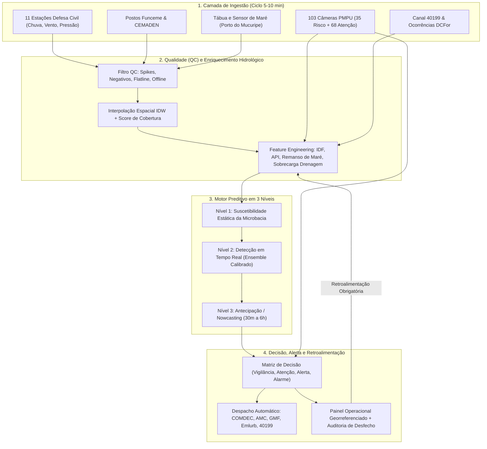

# Análise Crítica do Planejamento e Arquitetura do SADC-Fortaleza
**Sistema de Alerta e Detecção de Alagamentos Críticos de Fortaleza (SADC-Fortaleza)**

---

## 1. Visão Geral Executiva

O planejamento proposto apresenta um **recorte estratégico cirúrgico e altamente aderente à realidade geomorfológica e urbana de Fortaleza**. Ao deslocar o paradigma de "cheia de grande bacia fluvial" para **alagamento urbano rápido (flash urban flooding) governado por intensidade de curta duração, microdrenagem deficiente, saturação de canais/lagoas e bloqueio hidráulico por maré**, o desenho ataca exatamente a dinâmica responsável pelas quase 6 mil ocorrências registradas pela Defesa Civil entre 2021 e 2024.

Abaixo apresentamos a matriz completa de **Ratificação** (o que deve ser mantido integralmente), **Retificação** (o que precisa ser corrigido para evitar gargalos de modelagem e falsos alarmes) e **Aprimoramento Estrutural** (novas formulações matemáticas, hidrológicas e de Machine Learning implementadas neste repositório).

---

## 2. Ratificação: Pontos Fortes Validados e Mantidos

1. **Unidade de Previsão Descentralizada (Ponto Crítico / Microbacia)**:
   - **Por que está correto**: Fortaleza possui forte heterogeneidade microtopográfica. Uma chuva de $35\text{ mm/h}$ causa alagamento severo na bacia do Canal do Lagamar ou em pontos baixos do Jacarecanga, mas pode escoar sem danos em trechos mais elevados. Manter a malha centrada nas **65 Áreas de Risco**, **68 Pontos de Atenção (PMPU)** e microbacias (Cocó, Maranguapinho, Vertente Marítima, Ceará) é a decisão arquitetural correta.
2. **Arquitetura em Três Níveis (Estático $\rightarrow$ Tempo Real $\rightarrow$ Antecipação)**:
   - Separa corretamente a **vulnerabilidade estrutural do território (Nível 1)** da **forçante meteorológica e oceanográfica instantânea (Nível 2)** e da **projeção de curto prazo para tomada de decisão (Nível 3)**.
3. **Resolução Temporal de 10 Minutos**:
   - Totalmente alinhada à telemetria das 11 estações automáticas da Defesa Civil/Observatório e ao tempo de concentração ($T_c$) das microbacias urbanas impermeabilizadas de Fortaleza ($15\text{ a }45\text{ min}$).
4. **Foco Operacional Assimétrico ($\text{Recall} \ge 80\%$, $\text{Precisão } 50\text{--}70\%$ e $\text{Lead Time } 30\text{--}60\text{ min}$)**:
   - Em proteção e defesa civil, o custo de um **Falso Negativo** (alagamento severo sem alerta) é ordens de grandeza superior ao custo de um **Falso Positivo** em nível de Atenção/Alerta.
5. **Validação Visual e Retroalimentação Obrigatória (Human-in-the-Loop)**:
   - O uso das **103 câmeras do PMPU** (35 em áreas de risco e 68 em pontos de atenção) combinado aos chamados do **Canal 40199** resolve o maior problema de sistemas de alerta urbano: a falta de confirmação de desfecho (*ground truth*).
6. **Escolha das Áreas-Piloto (Jacarecanga, Padre Andrade, Aldeota e Itaoca)**:
   - Excelente cobertura de arquétipos hidrológicos distintos:
     - **Jacarecanga**: Zona baixa costeira/estuarina, forte influência de maré e remanso hidráulico.
     - **Padre Andrade**: Bacia do Maranguapinho, ocupação adensada próxima a canais e linhas de drenagem natural.
     - **Aldeota**: Altíssima impermeabilização ($>85\%$), escoamento superficial ultrarrápido por falha de microdrenagem (bocas de lobo/galerias) em picos de 10–15 min.
     - **Itaoca**: Bacia interiorana com influência de lagoas urbanas e canais, sensível ao acumulado de 3h–24h e chuva antecedente.

---

## 3. Retificações e Melhorias Estruturais nos Modelos

### 3.1. Retificação 1: Da Modelagem Isolada por Ponto para Arquitetura Global-Local Calibrada (Pooled GBDT + Calibração Isotônica)
* **Como estava no plano**: *"Fase inicial: regressão logística ou árvore de decisão por ponto crítico. Fase intermediária: Random Forest/XGBoost municipal... Fase avançada: LSTM"*.
* **Problema técnico identificado**:
  1. Treinar um modelo isolado apenas com os dados de um único ponto crítico sofre de **severa escassez de eventos positivos** (muitos pontos têm apenas 5 a 15 alagamentos confirmados em 3 anos), gerando *overfitting* extremo e limiares instáveis.
  2. Uma **LSTM pura** em séries pluviométricas de 10 minutos tende a prever a média condicional e **atrasar ou suavizar picos convectivos abruptos**, justamente os eventos da Quadra Chuvosa de Fortaleza (fev–mai) governados pela Zona de Convergência Intertropical (ZCIT).
* **Solução implementada no SADC-Fortaleza**:
  - **Arquitetura Híbrida Global-Local (Pooled Multi-Basin Ensemble)**: Um modelo unificado aprende a física de interação entre chuva, maré, topografia e drenagem usando todos os pontos críticos simultaneamente, enquanto preserva a especificidade local via **Atributos Estáticos de Microbacia (Nível 1)** + **Histórico Crônico Local** + **Limiar Operacional Calibrado Individualmente por Ponto Crítico ($ \tau_i $)** otimizando a métrica $F_{\beta}$ ($\beta = 2.0$, que atribui peso 4x maior ao Recall do que à Precisão).
  - **Calibração de Probabilidades**: Árvores de decisão e ensembles (Random Forest / Gradient Boosting) produzem escores distorcidos quando há desbalanceamento de classes. Aplicamos **Calibração de Probabilidade (Platt / Sigmoid & Isotonic Scaling)** em conjunto de validação temporal estrito para que $P(\text{alagamento}) = 0.70$ represente uma probabilidade real e auditável.

### 3.2. Retificação 2: Física do Bloqueio Hidráulico Costeiro (Interação Não-Linear Maré $\times$ Drenagem)
* **Como estava no plano**: Maré listada como variável isolada (*"altura e fase da maré, vento, pressão"*).
* **Melhoria implementada**:
  - Em bairros costeiros ou estuarinos (**Jacarecanga**, Moura Brasil, Pirambu, Foz do Cocó), a maré alta sozinha não alaga vias fora de eventos extremos de ressaca, mas **impede o escoamento das galerias pluviais e canais** quando chove simultaneamente (efeito de remanso hidráulico ou *backwater effect*).
  - Criamos o **Índice de Bloqueio Hidráulico por Maré ($I_{\text{remanso}}$)**:
    $$I_{\text{remanso}}(t, i) = \max\left(0, \frac{H_{\text{maré}}(t) - H_{\text{crítica}}}{H_{\text{máx}} - H_{\text{crítica}}}\right) \times \exp\left(-\frac{\text{Cota}_i}{\lambda_z}\right) \times \left(1 + \alpha \cdot \frac{dH_{\text{maré}}}{dt}\right) \times I_{\text{chuva\_1h}}(t)$$
    Onde $dH_{\text{maré}}/dt > 0$ (maré enchente) amplifica a retenção hídrica nas galerias costeiras de baixa cota ($\text{Cota}_i < 6\text{ m}$).

### 3.3. Retificação 3: Índice de Precipitação Antecedente Contínuo ($API_k$) e Razão Intensidade/Capacidade (Curva IDF Fortaleza)
* **Como estava no plano**: Acumulados discretos (1h, 3h, 6h, 12h, 24h) e menção qualitativa a "chuva antecedente".
* **Melhoria implementada**:
  1. **Janelas de Curto Prazo para Microdrenagem**: Adição explícita de $R_{10\text{min}}$, $R_{30\text{min}}$ e **Intensidade Equivalente Horária de Pico ($I_{15\text{min}} \text{ em mm/h}$)**.
  2. **Razão de Sobrecarga de Drenagem ($\rho_{\text{drenagem}}$)**: Compara a intensidade observada em 15–60 min com a capacidade efetiva da rede local penalizada pelo fator de obstrução (lixo/assoreamento/bocas de lobo):
     $$\rho_{\text{drenagem}}(t, i) = \frac{I_{15\text{min}}(t, i)}{C_{\text{projeto}, i} \cdot (1 - O_{\text{obstrução}, i})}$$
  3. **Antecedent Precipitation Index ($API$)**: Memória hidrológica de 72h com decaimento exponencial $k_i \in [0.85, 0.96]$ ajustado pela fração de solo permeável e presença de lagoas/canais amortecedores na bacia.

### 3.4. Retificação 4: Interpolação Espacial com Indicador de Incerteza de Cobertura
* **Como estava no plano**: *"Interpolação espacial por bairro/microbacia, ponderada pela distância"*.
* **Melhoria implementada**:
  - Além do **IDW (Inverse Distance Weighting)** com filtro automático de estações *offline* ou com falha de telemetria, o pipeline calcula o **Raio Efetivo de Confiança Pluviométrica ($D_{\min}$ e Entropia Espacial)**. Se a estação mais próxima de uma área de risco cair, o sistema repondera instantaneamente usando as estações vizinhas (Defesa Civil + Funceme + CEMADEN) e sinaliza a incerteza no painel operacional.

### 3.5. Retificação 5: Fusão de Rótulos (Ground Truth Scoring) para Mitigar Viés do Canal 40199
* **Como estava no plano**: Uso direto de registros históricos e chamados 40199.
* **Melhoria implementada**:
  - Chamados telefônicos/SMS isolados podem conter ruído ou imprecisão geográfica. Implementamos uma **Regra de Consenso de Rótulo**:
    - Confirmado Grau A (Peso $1.0$): Confirmação visual por câmera PMPU ($\text{lâmina} \ge 15\text{ cm}$) **OU** vistoria in loco da Defesa Civil.
    - Confirmado Grau B (Peso $0.85$): Cluster de $\ge 2$ chamados no 40199 na mesma microbacia em janela de 60 minutos.
    - Suspeito/Não Confirmado: Chamado único sem resposta de câmera (usado apenas para auditoria, não contamina o treinamento supervisionado como falso positivo).

---

## 4. Arquitetura Técnica Implementada no Repositório

